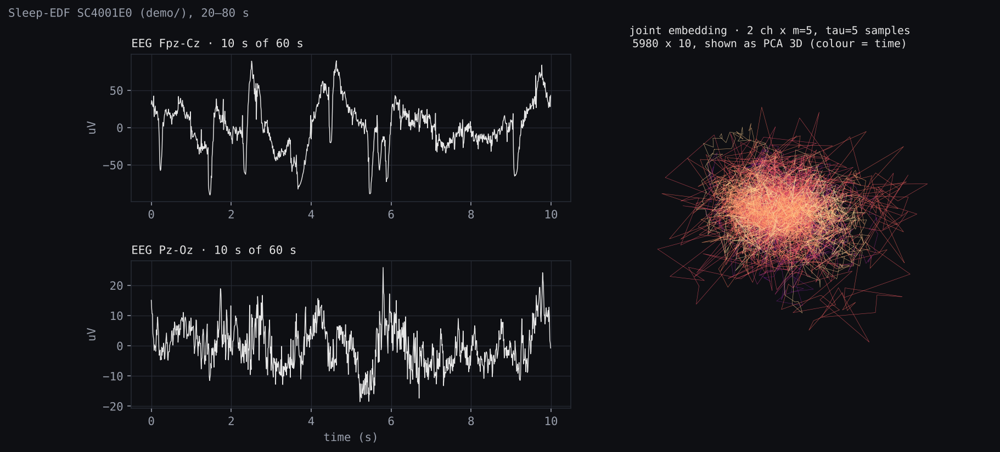
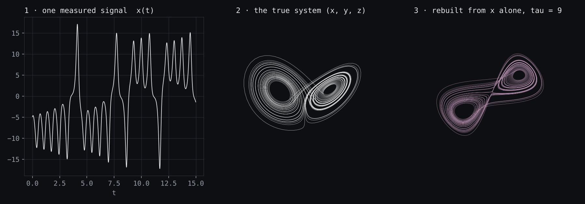
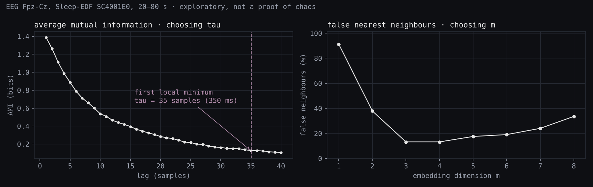
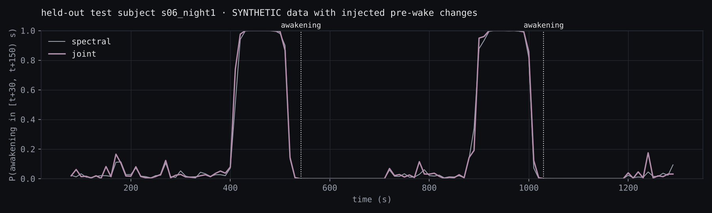

# EEG en el espacio de estados

**¿Puede la geometría de una señal cerebral anticipar un despertar mejor que su espectro?**

Herramienta de investigación para reconstruir EEG multicanal en un espacio de estados (embedding de Takens) y medir, con un protocolo causal y sujetos separados, si esa geometría añade información predictiva a las potencias espectrales. Incluye un visor interactivo y un flujo reproducible de entrenamiento, evaluación e inferencia.

<p align="center">
  
</p>

> [!NOTE]
> **Estado:** implementación comprobada con pruebas automáticas y datos sintéticos. **No incluye un modelo validado en personas.** Una trayectoria reconstruida no demuestra un atractor, caos ni un diagnóstico.

## Contenido

- [La idea](#la-idea)
- [Cómo se ve en EEG real](#cómo-se-ve-en-eeg-real)
- [Inicio rápido](#inicio-rápido)
- [Demostración completa](#demostración-completa)
- [Pregunta y protocolo](#pregunta-y-protocolo)
- [Datos reales](#datos-reales)
- [Entrenar y comparar](#entrenar-y-comparar)
- [Inferencia sin hipnograma](#inferencia-sin-hipnograma)
- [Estructura del repositorio](#estructura-del-repositorio)

## La idea

Del cerebro solo medimos unas pocas señales, pero detrás hay un sistema con muchísimas variables. El teorema de Takens dice que, bajo ciertas condiciones, una sola señal y sus copias retrasadas bastan para reconstruir una figura equivalente a la del sistema completo:

$$
X_n = \big(x_n,\; x_{n-\tau},\; x_{n-2\tau},\; \dots,\; x_{n-(m-1)\tau}\big)
$$

con retardo $\tau$ y dimensión $m$. Con el sistema de Lorenz se ve claramente: a partir de $x(t)$ solamente, reaparece la mariposa.

<p align="center">
  
</p>

`lorenz.py` es la versión interactiva de esta figura, con un control deslizante para cambiar $\tau$.

En EEG la figura no es tan limpia: hay ruido, varias fuentes mezcladas y no hay garantía de un sistema determinista. Por eso aquí no se busca *ver* un atractor, sino medir si la geometría de la reconstrucción **predice algo** que el espectro no captura.

## Cómo se ve en EEG real

Para $C$ canales, cada punto concatena las $m$ coordenadas retrasadas de todos ellos, así que vive en $\mathbb{R}^{C\cdot m}$. El cálculo conserva todas esas dimensiones; las figuras muestran una proyección PCA en 3D.

Para elegir $\tau$ y $m$ se usan dos diagnósticos exploratorios: la **información mutua promedio** (primer mínimo local) y los **falsos vecinos cercanos** (la dimensión a partir de la cual dejan de caer):

<p align="center">
  
</p>

Las tres figuras se generan con el código del paquete sobre la noche incluida en `demo/`:

```bash
python scripts/make_figures.py
```

## Inicio rápido

Requiere Python 3.10 o posterior. Desde la raíz del repositorio:

```bash
python -m venv .venv
source .venv/bin/activate
python -m pip install -e '.[dashboard,test]'
python -m pytest -q
python atractor.py
```

Abre http://127.0.0.1:8050. Para entrenar sin interfaz basta `python -m pip install -e '.[eeg]'`.

Hay dos interfaces:

| | Qué hace |
|---|---|
| `python atractor.py` → puerto **8050** | **Dashboard de análisis de un canal:** señal en el tiempo, atractor 3D, densidad espectral, distribución por bandas, métricas de calidad y búsqueda automática de $\tau$ y dimensión. |
| `python forecast_viewer.py` → puerto **8051** | **Explorador multicanal y pronóstico:** varios canales a la vez, retardo fijo y de 2 a 12 dimensiones por canal, AMI, falsos vecinos, y la pestaña **Probabilidad de despertar**, que abre los CSV generados por la línea de comandos. |

<p align="center">
  
</p>

En el explorador multicanal, el color indica tiempo y cada ventana se proyecta con su propio PCA, así que los ejes **no son comparables entre figuras**. El entrenamiento se ejecuta con comandos, no dentro de la interfaz.

## Demostración completa

```bash
python -m awakening demo --output data/synthetic
python -m awakening train \
  --manifest data/synthetic/manifest.json \
  --output results/synthetic
python -m awakening predict \
  --model results/synthetic/joint.joblib \
  --signal data/synthetic/s06.npz \
  --output results/synthetic/inference.csv
```

La demo genera ocho sujetos artificiales con dos canales y cambios predespertar **introducidos a propósito**. Sirve para probar el software, **no para medir rendimiento fisiológico**.

<p align="center">
  
</p>

La probabilidad sube entre 30 y 150 s antes de cada despertar, que es exactamente la ventana que el modelo aprende a anticipar. En estos datos, los modelos espectral, individual y conjunto detectan los cuatro eventos de prueba sin falsas alarmas. La geometría **no mejora** al espectro (ver [validación](docs/VALIDATION.md)).

Los directorios de salida deben ser nuevos: no se sobrescriben resultados anteriores. Ni los datos generados ni los modelos entrenados se suben a Git.

## Pregunta y protocolo

> ¿Las características de una reconstrucción multicanal añaden información predictiva a las potencias espectrales para anticipar un despertar sostenido?

| | Elección predeterminada |
|---|---|
| **Evento** | Inicio de al menos 60 s de vigilia continua, justo después de al menos 120 s de sueño continuo |
| **Observación** | Últimos 60 s de señal; una decisión cada 10 s |
| **Objetivo** | Que el evento empiece en $[t+30\,\text{s},\ t+150\,\text{s})$: al menos 30 s de anticipación y una ventana de 120 s |
| **Filtrado** | Butterworth causal, orden de diseño 4, 0.5–35 Hz, sin decimación; se descartan los primeros 20 s |
| **Embedding** | 4 bloques de coordenadas por canal, retardo nominal de 50 ms, ventana de Theiler de 1 s |
| **Ventanas puntuadas** | Todas las válidas, **incluida la vigilia**; la etiqueta experta del estado actual nunca habilita alertas |
| **Umbral de alerta** | Elegido solo con sujetos de validación, con un presupuesto de 0.5 falsas alarmas por hora evaluada |

Son decisiones iniciales configurables, no parámetros clínicamente óptimos. El modelo no pronostica que el despertar ocurrirá exactamente dos minutos después: avisa entre 30 y menos de 150 s antes.

## Datos reales

Consulta [examples/manifest.example.json](examples/manifest.example.json) y [docs/METHODS.md](docs/METHODS.md).

El manifiesto fija el orden de los canales y describe cada noche: identificador, sujeto, partición, señal y anotaciones.

```json
{
  "channels": ["EEG Fpz-Cz", "EEG Pz-Oz"],
  "recordings": [
    {
      "id": "subject01_night1",
      "subject": "subject01",
      "split": "train",
      "signal": "subject01-PSG.edf",
      "annotations": "subject01-Hypnogram.edf",
      "annotation_offset_s": 0
    }
  ]
}
```

Un experimento necesita las tres particiones `train`, `validation` y `test`, con sujetos distintos en cada una, casos positivos y negativos en entrenamiento y eventos evaluables en validación. Todas las noches de un mismo sujeto van en la misma partición, y el programa rechaza archivos o sujetos repetidos entre particiones. No asignes identificadores distintos a noches de la misma persona. Conviene tener varios sujetos por partición para estimar la incertidumbre.

| Datos | Formato y contrato |
|---|---|
| EEG y otros canales de voltaje | EDF/BDF/FIF/SET mediante MNE; unidades internas en V. Selecciona canales y verifica su montaje y referencia. |
| NPZ | `data`: muestras × canales; `channels`: nombres; `fs`: Hz; `unit`: `V` o `uV`. Sin objetos pickle. |
| CSV/TSV/TXT | Columnas seleccionadas por nombre; declara `fs` y `unit`, o una `time_column` regular en segundos. |
| NPY | Muestras × canales en el orden del manifiesto; declara `fs` y `unit`. No se adivina la orientación. |
| Hipnograma CSV | `onset,duration,stage`, en segundos desde el inicio de la señal. Etapas W, N1, N2, N3, REM. |
| Hipnograma EDF+ | Anotaciones de Sleep-EDF; R se mapea a REM y las etapas 3 y 4 a N3. |

La línea de comandos acepta archivos SET con sus archivos auxiliares junto al original. El visor acepta SET autocontenidos; para un SET que dependa de un FDT, usa la línea de comandos o conviértelo antes.

**Nada se corrige en silencio.** No se borran huecos ni se interpolan datos: señales con NaN, relojes irregulares o ventanas planas detienen el análisis con un error. Las anotaciones desconocidas o incompletas excluyen ventanas de la evaluación. Comprueba la alineación temporal entre el PSG y el hipnograma.

**Archivos de ejemplo en `demo/`:**

| Archivo | Qué es |
|---|---|
| `SC4001E0-PSG.edf` | Una noche de [Sleep-EDF Expanded](https://physionet.org/content/sleep-edfx/), 100 Hz, sin su hipnograma |
| `chb14_11(183).edf` | Un registro del CHB-MIT Scalp EEG Database |
| `PRO_Case01_20210319_EME10.tsv` | Un registro multicanal en texto |

Una sola noche sin etiquetas sirve para explorar el visor, pero no para entrenar ni evaluar. Sleep-EDF Expanded ofrece los registros con sus hipnogramas. Ojo: sus etiquetas de sueño y vigilia no equivalen a anotaciones de microdespertares.

## Entrenar y comparar

```bash
python -m awakening train \
  --manifest data/my-study/manifest.json \
  --config examples/config.json \
  --false-alarms-per-hour 0.5 \
  --output results/my-study-v1
```

Se entrenan cuatro modelos definidos de antemano:

| Modelo | Características |
|---|---|
| `prevalence` | Probabilidad constante estimada en entrenamiento |
| `spectral` | Potencias relativas por banda, log RMS y cambios respecto a la decisión anterior |
| `individual` | Espectro más la geometría de cada canal por separado |
| `joint` | Espectro más la geometría del embedding multicanal conjunto |

Los modelos 2–4 son regresiones logísticas con escalamiento ajustado **solo en entrenamiento** y sin ponderación de clases que distorsione las probabilidades. Son una referencia interpretable, no el mejor modelo posible. No se incluye un modelo temporal de estados de sueño: requeriría obtener los estados pasados sin etiquetas expertas durante la inferencia.

**Salidas:**

- `summary.md`, `report.json`: métricas, configuración, versiones, hashes de los archivos y comparación `joint` contra `spectral`.
- `features.csv`, `events.csv`: características y eventos, con sujeto, noche y partición.
- `*_validation_thresholds.csv`: exploración de umbrales, hecha únicamente en validación.
- `*_test_predictions.csv`, `*_test_alerts.csv`: probabilidades y alertas en prueba.
- `*_test_recordings.csv`, `*_test_reliability.csv`: detalle por registro y calibración por intervalos.
- `*.joblib`: modelos con el orden de canales y características, la configuración y el umbral.

El informe incluye sensibilidad por evento, falsas alarmas por hora, tiempo en alerta, anticipación, Brier, average precision, ROC-AUC y bootstrap por sujeto. El mejor modelo nunca se elige mirando el test. La comparación principal es `joint` menos `spectral`, y debe leerse junto con sus falsas alarmas: el límite de falsas alarmas se fija en validación y puede no cumplirse en sujetos nuevos.

## Inferencia sin hipnograma

```bash
python -m awakening predict \
  --model results/my-study-v1/joint.joblib \
  --signal data/new-night.edf \
  --output results/new-night-predictions.csv
```

Para CSV o NPY añade `--fs` y `--unit`; para CSV con columna de tiempo también puedes usar `--time-column`. El orden de canales lo determina el modelo. Se rechaza una frecuencia de muestreo distinta a la del entrenamiento: requiere un remuestreo causal documentado o reentrenar.

> [!WARNING]
> Carga solo modelos `.joblib` de procedencia confiable: el formato ejecuta código Python al deserializarse.

La inferencia simula decisiones causales sobre un archivo: cada decisión depende exclusivamente de su pasado. No incluye adquisición en vivo desde un amplificador, notificaciones ni actuadores. Antes de interpretar probabilidades, verifica que canales, referencia, población y muestreo sean compatibles con el entrenamiento.

## Estructura del repositorio

```
awakening/
  io.py, labels.py           lectura de datos y definición de eventos
  features.py                filtrado causal, embedding, geometría y espectro
  diagnostics.py             AMI, falsos vecinos, curva de correlación, sustitutos
  dataset.py                 ventanas, procedencia y censura del final del registro
  model.py, evaluation.py    entrenamiento, umbrales, métricas y comparación
  cli.py, demo.py            comandos y ejemplo sintético
atractor.py                  dashboard de análisis de un canal (Dash)
forecast_viewer.py           explorador multicanal y visor de probabilidades (Dash)
lorenz.py                    demostración interactiva de Takens con Lorenz
scripts/make_figures.py      genera las figuras de este README
tests/                       causalidad, sincronización, eventos, particiones, inferencia y visor
docs/                        métodos, validación y figuras
```

**Documentación:** [métodos y limitaciones](docs/METHODS.md) · [validación realizada](docs/VALIDATION.md).

`technical_report.pdf` y `slides(ES).pdf` describen la etapa anterior del proyecto, centrada en el dashboard; no documentan el protocolo de pronóstico.
